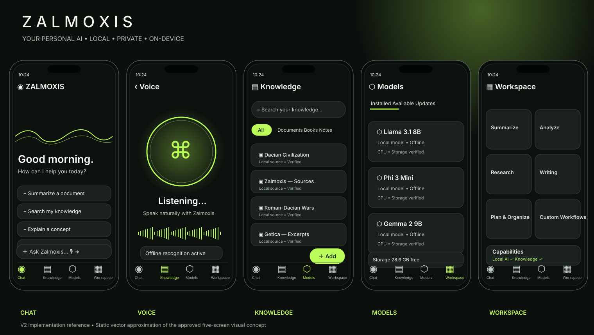

<div align="center">

# ZALMOXIS

### Private AI, built for your Android device.

**A local-first Android AI assistant with on-device language models, personal knowledge, and user-controlled connections to other AI agents.**

[Overview](#overview) · [Features](#features) · [Install](#get-the-app) · [Build](#build-from-source) · [MCP](#connect-other-ai-agents) · [Roadmap](ROADMAP.md)

[](https://github.com/andreipath26/zalmoxis/actions/workflows/android-build.yml)
[](https://github.com/andreipath26/zalmoxis/actions/workflows/bridge-check.yml)

**Android 8.0+** · **Kotlin / Jetpack Compose** · **Local-first** · **Under active development**

</div>

---

## Overview

Zalmoxis is an Android assistant designed to make capable AI more useful **without making cloud inference the default**. Compatible models run on your phone. Personal source material stays in app-private storage. Interactions with outside services—such as model downloads, public GitHub research, or agent messaging—are explicit and visible.

The project combines five main experiences: **Chat, Voice, Knowledge, Models, and Workspace**. It also explores a more flexible way to work with other AI systems: an MCP server hosted inside the Android app, plus an optional internet-hosted bridge.

> [!IMPORTANT]
> **Development status:** This is a working, actively developed source project—not a production-certified Android release. Successfully building an APK does not establish compatibility with every device or model, and MCP compilation does not mean a hosted service or external provider is already connected.

## The Zalmoxis experience



*Zalmoxis V2 design storyboard. This is a concept illustration, not screenshots captured from a running Android device.*

## Features

| Area | What is implemented in source | Important limitations |
| --- | --- | --- |
| **On-device chat** | LiteRT-LM integration for compatible models, streamed answers, and supported image-capable model flows | Model compatibility, performance and memory requirements depend on the phone and model |
| **Model library** | Import and manage local model files; optional reviewed, digest-checked catalog downloads | Models are not bundled with every build; catalog examples do not guarantee that a model will run |
| **Personal Knowledge** | App-private source storage; local text/Markdown search; source provenance, SHA-256 receipts and deletion flows | Not every document format can be extracted or indexed |
| **Voice** | Android on-device speech recognition and offline-capable installed voice output | Availability depends on Android and language/voice packages installed on the device |
| **Research** | User-initiated public GitHub discovery and review before saving sources or AI drafts to Knowledge | This is not general-purpose web browsing or autonomous web research |
| **App updates** | GitHub release checking, APK integrity verification and Android installer handoff | Signed-update publishing requires persistent maintainer signing credentials; installation needs real-device validation |
| **Agent Bridge** | Local MCP server, Android approval UI, optional hosted message transport implementation | External providers and hosted infrastructure still require deployment and interoperability testing |

Zalmoxis does **not** claim to be a fully autonomous phone-controlling agent. Remote inputs do not receive blanket permission to read your files, operate Android, or write to Knowledge.

## Get the app

### Download a development APK

The [Android build workflow](https://github.com/andreipath26/zalmoxis/actions/workflows/android-build.yml) creates a **debug APK** on successful builds.

1. Open [GitHub Actions → Android build](https://github.com/andreipath26/zalmoxis/actions/workflows/android-build.yml).
2. Select a recent **successful** run on `main`.
3. Under **Artifacts**, download `zalmoxis-debug-apk` and extract the ZIP.
4. Transfer the APK to your Android device, open it and follow Android's installation prompts.

A debug APK is intended for testing. It is not a Google Play release, may have limited support, and is not necessarily signed with the certificate used for installable updates. **Back up app-private data before replacing a build signed with a different certificate.**

A persistently signed `zalmoxis-update.apk` can be published as a GitHub pre-release **only when the required repository signing secrets are configured and the publication job succeeds**. Check [Releases](https://github.com/andreipath26/zalmoxis/releases) rather than assuming every successful debug build creates a signed release.

### Build from source

**Prerequisites:** JDK 17, Android SDK Platform **37.1**, Android SDK Build Tools **36.0.0**, and the Android/Gradle dependencies configured by the project.

```bash
git clone https://github.com/andreipath26/zalmoxis.git
cd zalmoxis/android
./gradlew :app:assembleDebug --no-daemon
```

Output: `android/app/build/outputs/apk/debug/app-debug.apk` (relative to the repository root).

Install on a connected test device with Android Debug Bridge:

```bash
adb install -r app/build/outputs/apk/debug/app-debug.apk
```

The `adb` command above is run from the `android/` directory. Use the device manufacturer's installation and developer-mode guidance where applicable.

## Connect other AI agents

Zalmoxis supports **two independently operated MCP connection paths**. They serve different purposes, and neither is a substitute for authorization.

### 1. Local MCP server — on your phone

Inside the Android app, open **Workspace → Agent Bridge → Start local server**.

| Setting | Value |
| --- | --- |
| Transport | MCP Streamable HTTP, via the [official Kotlin MCP SDK](https://github.com/modelcontextprotocol/kotlin-sdk) and Ktor |
| Local endpoint | `http://127.0.0.1:8765/mcp` |
| Network binding | `127.0.0.1` (phone loopback only) |
| Authentication | Locally generated bearer token; reveal or copy it from the Agent Bridge screen |
| Initial tools | `status`, `submit_task`, `read_reply` |
| Execution model | Incoming tasks wait for explicit user review and response |

The local server runs as a user-started Android foreground service with a visible notification. The Android UI also provides reply drafting using the on-device model, subject to user review. **The local server does not require a Cloudflare account or a model API key.**

**Important:** `127.0.0.1` is reachable from the phone itself, not from ChatGPT or another service somewhere on the internet. A localhost MCP server does not, by itself, create a remote connection. Do not publish the bearer token in screenshots, issues, logs, or messages.

### 2. Internet-hosted MCP bridge — optional

The repository also contains the hosted implementation:

- [MCP resource server](bridge/mcp-server/) using the MCP TypeScript SDK, Cloudflare Agents and OAuth resource authorization.
- [OAuth authorization service](bridge/auth-server/) using Cloudflare Access identity and user consent.
- [Cloudflare D1 schema](bridge/migrations/) for paired message queues.
- [Android hosted bridge client](android/app/src/main/kotlin/com/zalmoxis/app/AgentBridgeClient.kt) with secure device-token storage.
- [Deployment and security guide](bridge/README.md) and [DeepSeek Harness notes](bridge/deepseek/README.md).

The intended hosted workflow is: deploy the OAuth/MCP Workers, authorize a compatible MCP client, generate a short-lived pairing code, then pair the phone in **Workspace → Agent Bridge**. Agent requests are queued for user approval, and replies can be collected through the provider's MCP connection.

**Hosted availability is not guaranteed by the source repository.** Cloudflare resources, domain/Access configuration, account authorization and live connection tests must be completed by the deployer. No hosted instance is advertised as already operational.

### 3. Using both

The Agent Bridge interface can show **Off**, **Local**, **Hosted**, or **Hybrid**, depending on which services are active. Today, **Hybrid means the local server and hosted client can operate at the same time**; it does not yet provide automatic task forwarding, seamless failover, or unified encrypted routing. A direct secure tunnel from the phone to the internet is planned, not shipped.

### No model API key ≠ no account requirements

On-device inference does not require a commercial inference API key. The bridge is designed to work with compatible account-authenticated MCP clients, including DeepSeek Harness integrations, without embedding their model API keys in Zalmoxis. External clients may nevertheless require **their own account, product-plan capability, OAuth consent or hosting credentials**, and integration support depends on the provider. Do not assume that a consumer chat session can be contacted or awakened automatically.

## Privacy and security

**Local by default** describes the inference and personal storage design; it does not mean every feature is offline:

- Model downloads contact the model host (including Hugging Face for catalog assets).
- Research searches public GitHub endpoints **only when initiated**.
- Hosted Agent Bridge messages leave the device over HTTPS when that mode is used.
- **The current hosted D1 queue stores message bodies as plaintext until expiry. Do not send sensitive personal data or private Knowledge through it.** End-to-end encryption is a roadmap requirement, not a current guarantee.
- The local MCP server listens on loopback and still requires a bearer token; other phone apps can potentially reach localhost.
- The app does not silently grant third-party agent messages access to Android controls or the Knowledge database.
- On-device model availability, Android permissions and background service behavior depend on the handset and OS configuration.

For threat assumptions and planned mitigations, see the [threat model](THREAT-MODEL.md).

## Architecture

```text
                          ZALMOXIS Android
 ┌────────────────────────────────────────────────────────────┐
 │  Chat · Voice · Models · Knowledge · Workspace              │
 │                                                            │
 │  On-device model runtime      App-private Knowledge store  │
 │              │                            │                │
 │              └──────── User review / approval ────────────┤
 │                                            │               │
 │  Local MCP server (127.0.0.1) ◄────────────┤               │
 │  Hosted bridge client ─────────────────────┘               │
 └────────────────────────────────────────────────────────────┘
                          │ optional HTTPS
                          ▼
            Hosted MCP + OAuth + message queue
                          │
                          ▼
              Compatible external MCP clients
```

| Component | Technology |
| --- | --- |
| Android app | Kotlin, Jetpack Compose, Material 3 |
| Local model runtime | Google AI Edge LiteRT-LM |
| Local MCP server | Official Kotlin MCP SDK, Ktor CIO, Android foreground service |
| Hosted bridge | TypeScript MCP SDK, Cloudflare Workers/Agents, OAuth, D1 |
| Build and CI | Gradle, GitHub Actions |
| Local source management | App-private file storage, SHA-256 verification |

## Project status and direction

This repository tracks implementation and validation separately. **A feature present in source is not automatically considered deployed, tested on real devices, or safe for unrestricted external access.**

**Implemented in source:** Android chat/model/Knowledge experiences, embedded local MCP server with reviewable task inbox, hosted OAuth/MCP bridge modules, and CI checks.

**Still being validated or developed:** live external-provider round trips, hosted deployment, direct phone tunnelling, durable local queue, encryption of hosted message payloads, unified hybrid routing, broad model/device compatibility and signed-update installation testing.

For the full development plan and acceptance criteria, read the [master roadmap](ROADMAP.md) and [project state](PROJECT-STATE.md).

## Repository guide

| Path | Purpose |
| --- | --- |
| [`android/`](android/) | Android application and local MCP server |
| [`bridge/`](bridge/) | Hosted MCP bridge, OAuth services, schema and deployment documentation |
| [`docs/assets/`](docs/assets/) | UI design illustrations and project assets |
| [`ROADMAP.md`](ROADMAP.md) | Milestones, future work and release gates |
| [`PROJECT-STATE.md`](PROJECT-STATE.md) | Recorded project state |
| [`THREAT-MODEL.md`](THREAT-MODEL.md) | Security and trust boundaries |
| [`RECOVERY-PLAN.md`](RECOVERY-PLAN.md) | Recovery and continuity plan |
| [`KILL-CRITERIA.md`](KILL-CRITERIA.md) | Criteria for reconsidering or stopping an approach |

## Contributing and feedback

Zalmoxis is in active development. Bug reports and technical feedback are welcome through [GitHub Issues](https://github.com/andreipath26/zalmoxis/issues). Useful reports include the Android version, device model, affected screen or feature, reproduction steps and a sanitized log. **Never include local MCP bearer tokens, account credentials or personal Knowledge contents.**

Before contributing code, review the roadmap and project security boundaries. New integrations should preserve local-first defaults, explicit user consent and separation between untrusted model output and privileged device actions.

## Licensing

**No repository-wide license has been published at this time.** Public source visibility does not itself grant permission to copy, modify or redistribute this repository. Dependencies and model weights may have separate licenses.

---

<div align="center">

**Zalmoxis is being built to make personal AI useful without giving up control of the device or your data.**

[View the roadmap](ROADMAP.md) · [Report an issue](https://github.com/andreipath26/zalmoxis/issues) · [See build results](https://github.com/andreipath26/zalmoxis/actions)

</div>
